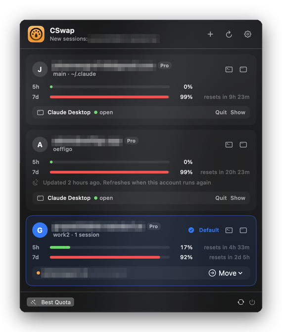

<div align="center">


# CSwap

Several Claude accounts on one Mac, all logged in at once. A menu bar app and the `cswap` command for Claude Code and Claude Desktop, with live usage for every account.

[](https://github.com/jx-grxf/cswap/actions/workflows/ci.yml)
[](https://github.com/jx-grxf/cswap/releases/latest)


[](LICENSE)

[Download](https://github.com/jx-grxf/cswap/releases/latest) · [How it works](docs/how-it-works.md) · [Release notes](release-notes/) · [Contributing](CONTRIBUTING.md)

<br>



</div>

> [!TIP]
> Built for the moment the 5-hour limit hits in the middle of a task and you have a second account with quota left. Type `/swap`, and two seconds later the same conversation continues on the other account in the same terminal tab.

## What it does

**Claude Code**

- Every account gets its own configuration folder (`CLAUDE_CONFIG_DIR`), the setup Anthropic [documents for multiple accounts](https://code.claude.com/docs/en/authentication#log-in-with-multiple-accounts). Each one logs in once and stays logged in.
- Settings, skills, plugins, hooks, agents, commands, memory and transcripts are shared with your normal `~/.claude`. User MCP servers and per-project trust follow every account.
- `/swap` inside a running session resumes the same conversation with another account, in the same tab. It works when the current account is already out of quota.
- `cswap use work` or a click in the menu sets the account new `claude` sessions start with. When it hits its 5-hour or weekly limit, new sessions move to the account with the most quota left.

**Claude Desktop**

- One Claude Desktop window per account, side by side, each with its own login. The app itself has no account switcher; without this you log out and in again.
- Your existing Desktop login shows up under the account it belongs to. MCP servers from your normal Desktop config carry over to the other windows.
- Open, bring to the front or quit each window from the menu or with `cswap desktop <name>`.

**Menu bar**

- 5-hour, weekly and per-model usage for every account, with reset times and how old cached numbers are.
- Running Claude Code sessions per account, busy or idle, with **Move to …** to continue one on another account.
- Add an account, log one in again, open Claude Code or Claude Desktop with it.
- A warning when two accounts are logged in to the same claude.ai account.
- Starts at login and updates itself through Sparkle, with a Stable and a Beta channel.

CSwap never writes, refreshes or copies a login. It reads the current access token to ask for usage, nothing else. [How it works](docs/how-it-works.md) explains why that matters.

## Install

1. Download `CSwap-<version>.zip` from the [latest release](https://github.com/jx-grxf/cswap/releases/latest), unzip it and move **CSwap.app** to `/Applications`. The app is signed with a Developer ID and notarized.
2. Open it. A gauge icon appears in the menu bar.
3. Click **Set Up** in the popover, or run the guided setup in a terminal:

   ```sh
   /Applications/CSwap.app/Contents/MacOS/cswap setup
   ```

   Setup links `cswap` into `~/.local/bin`, adds one line to your shell startup file, installs the `/swap` command into `~/.claude/commands` and walks you through logging in your accounts.
4. Open a new terminal tab so the shell picks up the change.

**Requirements:** macOS 14 or later, [Claude Code](https://code.claude.com) installed, zsh or bash (including the bash 3.2 macOS ships). New windows open in Ghostty when it is installed, Terminal.app otherwise.

### Upgrading from Claude Swap Bar 1.x

Your `~/.claude` login becomes the `main` account. Add other accounts again with `cswap add`; the 1.x account list isn't imported. Run `cswap setup` once and delete the old `ClaudeSwapBar.app`. Setups that used `cseat` keep working: `cswap setup` migrates the shell line and keeps `cseat` as an alias.

## Using the CLI

Your normal `~/.claude` login is the `main` account. Add a second one:

```sh
cswap add work --email you@company.com
```

This creates the account and opens Claude Code's login screen. The browser authorizes whichever claude.ai account it is signed in to, so switch accounts there first or paste the link into a private window. `cswap` warns when the login doesn't match `--email`.

Then run `cswap` without arguments to see every account:

```text
$ cswap
  main     you@example.com Pro
           5h ████░░░░░░░░░░░░░░░░  18%  resets in 3h 54m
           7d █████████████████░░░  83%  resets in 2d 7h
● work     you@company.com Max  default  2 running
           5h ██████████████░░░░░░  71%  resets in 1h 12m
           7d ███████████░░░░░░░░░  57%  resets in 4d 3h
```

The dot marks the default account, the one plain `claude` starts.

### Commands

| Command | What it does |
|---|---|
| `cswap` | Show every account with its usage |
| `cswap work [args…]` | Start Claude Code with the `work` account; arguments pass through to `claude` |
| `cswap work --bp` | Same, with `--dangerously-skip-permissions` |
| `claude [args…]` | Start the default account |
| `cswap add <name> [--email a]` | Create an account and log it in |
| `cswap login <name>` | Log an account in again |
| `cswap use <name>` | Make it the default for new sessions |
| `cswap best` | Make the account with the most quota left the default |
| `cswap remove <name>` | Delete an account and its login; shared data stays |
| `/swap [account]` | Inside a session: continue it with another account |
| `cswap sessions` | List running sessions per account |
| `cswap desktop` | Show each account's Claude Desktop window |
| `cswap desktop <name> [--quit]` | Open, or quit, Claude Desktop with that account |
| `cswap move <name> --pid <pid>` | Move a running session from outside it |
| `cswap setup` | One-time guided setup; safe to run again |
| `cswap doctor` | Check the setup and every account |
| `cswap sync` | Re-link shared settings, skills and memory |
| `cswap version` | Print the version |

`/swap` without an account continues on the default account, or, if the session already runs there, on the logged-in account with the most quota left.

> [!IMPORTANT]
> Don't use `/login` inside a session to change accounts. It replaces the login of the account that session belongs to. Use `/swap`.

## Using the menu bar app

Click the gauge icon to open the menu.

- **Click an account** to make it the default for new sessions. **Best Quota** picks the account with the most quota left.
- The **terminal** button opens Claude Code with that account, the **window** button opens Claude Desktop with it. The first time, Desktop opens on its login screen; sign in there with that account.
- **Right-click an account** to log it in again, show its folders, quit its Desktop window or remove it.
- **Move to …** next to a running session continues it on another account.
- **Settings** (gear icon) sets the refresh interval, the automatic default switch, Claude Desktop, launch at login, the menu bar label and the update channel.

> [!IMPORTANT]
> With more than one Desktop window open, the Claude icon in the Dock only brings an existing window to the front. Open the account you want from CSwap.

## Uninstall

```sh
cswap remove <name>          # for each extra account; removes its login
rm ~/.local/bin/cswap
rm -rf ~/.cswap
```

Then delete the `cswap` lines from your shell startup file, `~/.claude/commands/swap.md` and `/Applications/CSwap.app`. Your `~/.claude` stays as it was.

## Development

```sh
git clone https://github.com/jx-grxf/cswap.git
cd cswap
swift build                          # compile everything
./script/build_and_run.sh            # build CSwap.app and launch it
./build-app.sh                       # ad-hoc signed; set SIGN_IDENTITY for Developer ID
```

[CONTRIBUTING.md](CONTRIBUTING.md) covers the layout, testing without touching your real accounts, and the release process. Issues and pull requests are welcome.

## License

[MIT](LICENSE) © Johannes Grof

CSwap is an independent project, not affiliated with or endorsed by Anthropic. Claude and Claude Code are trademarks of Anthropic, PBC.
